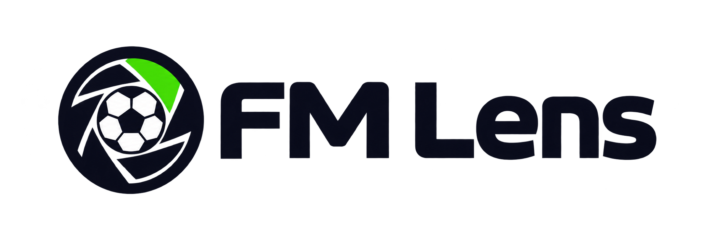
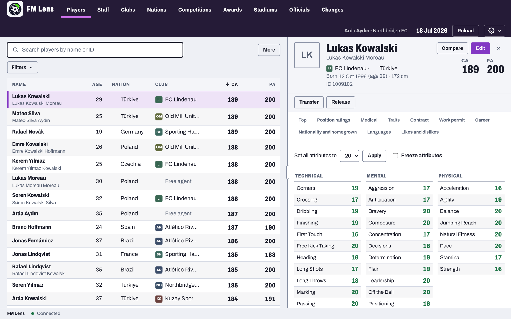

# FM Lens



FM Lens is a free companion for Football Manager 27 on Mac and Windows. It reads
the career you have loaded and lets you search, compare and edit players, staff and clubs while
FM runs.

**[Download FM Lens](https://getfmlens.com/download/)** for Apple Silicon and Intel
Macs or Windows from [getfmlens.com](https://getfmlens.com). FM Lens updates itself
after that.



## What you need

- A Mac with Apple Silicon or Intel, or a PC with 64-bit Windows 10 or 11.
- Football Manager 27 from Steam, version 27.0.1 (build 26385295) or 27.0.0
  (build 26340721). Other builds open read-only.
- A copy of your save to edit.

## Getting started

1. On a Mac, open the disk image and drag **FM Lens** onto **Applications**. The
   first time, open **System Settings › Privacy & Security** and choose **Open
   Anyway**. Then save and quit FM, quit Steam, and choose **Set up** in FM Lens.
   This adds a small helper that FM loads when Steam starts it.

   On Windows, run the installer. If Windows protected your PC, choose **More
   info**, then **Run anyway**. Windows needs no setup.
2. Start FM from Steam, load the copy of your save and choose **Connect**.

Edits go into FM when you press **Apply**. On the supported build, on Apple
Silicon, Intel or Windows, each successful Apply and Undo asks FM to refresh the
affected record and its active views, without advancing time. Attribute and
contract-expiry header refresh have been checked in FM on Apple Silicon and
Intel; other fields and panels have not all been verified.
**Changes** lists each one, with **Undo**. To take the Mac helper out again,
choose **Remove the helper** in FM Lens.

Found a problem? [Open an issue](https://github.com/IamDejman/fm-lens/issues/new/choose).
Questions and ideas go to [Discussions](https://github.com/IamDejman/fm-lens/discussions).

## What it does

- Search and filter players, staff and clubs. Browse nations, stadiums,
  competitions, awards and match officials.
- Edit attributes, CA and PA, positions, traits, personality, reputation,
  happiness and contracts, and club balances, budgets, facilities and stadiums.
- Grant work permits, change coaching licences, add injuries, start and end
  loans, and sign free agents.
- Heal injuries, lift bans, refresh fitness and sharpness, and set or freeze a
  player's attributes.
- Copy a player's profile onto others with templates, previewed first.
- Export to CSV or JSON. Light and dark appearance, 80 to 150% zoom and
  keyboard shortcuts.

## Limits

- Not every field has been tested through a save and reload in FM.
- Moving, swapping and releasing players may not update every linked record,
  such as history and finances.
- An unsackable manager has not been tested against a real sacking.

Test results are in the [editing validation record](docs/EDITING-VALIDATION.md).

## Build from source

Requirements: Xcode command-line tools, Rust stable, Node.js and npm.

```sh
export PATH="$HOME/.cargo/bin:$PATH"
cargo build --locked -p fmlens-probe -p fmlens-bridge
cd app
npm ci
npm run tauri -- build --debug --bundles app --config src-tauri/tauri.scout.conf.json
```

The app is `target/debug/bundle/macos/FM Lens.app`. Releases are built as
[Releasing](docs/DEVELOPING.md#releasing) describes.

## Documentation

- [Contributing and checks](CONTRIBUTING.md)
- [Developing and releasing](docs/DEVELOPING.md)
- [Feature status and roadmap](docs/ROADMAP.md)
- [Mapped editing fields](docs/EDITOR-FIELDS.md)
- [Editing tests and remaining validation](docs/EDITING-VALIDATION.md)
- [Current build and live verification](docs/PERSONAL-SCOUT.md)
- [Brand assets and generation prompts](docs/brand/FM-LENS.md)
- [Agent instructions](AGENTS.md)

## Privacy

FM Lens and [getfmlens.com](https://getfmlens.com) count use anonymously with
[PostHog](https://posthog.com), to know how many people use them and which
features matter. No names, no values you edit, no file paths and nothing you
type are sent. PostHog does not keep the IP address. For the app it keeps the
country and city the connection came from; for the site, not even that.

The app sends these events with a random install id, the app version, the macOS
or Windows version and processor, and the app language:

- `app_opened`: the app started.
- `fm_connected`: FM Lens connected to FM, with FM's version and store.
- `fm_connect_failed`: connecting to FM failed, with the kind of failure (such
  as `session.noCareer`), never its message.
- `tab_viewed`: a section opened, such as Players.
- `edit_applied`: an edit went into FM, with its kind (`move_player`, or the
  field changed, such as `contract.wage`), never the value.
- `card_exported`: a player's share card was copied or saved, with its size
  and whether it shows CA and PA.
- `change_undone`, `players_exported` and `report_sent`.

To stop it, turn off **Share anonymous usage** in Settings. Debug builds send
nothing.

Before it opens for the first time on a computer, the app asks for an email
address. It goes to [Kit](https://kit.com), which keeps the list and sends the
emails about FM Lens, and never to PostHog. Every email has a link to
unsubscribe.

The site counts page views, downloads started and email signups, without cookies
or stored ids. A download from the site asks for an email address, which goes to
[Kit](https://kit.com), which keeps the list and sends the emails, and never to
PostHog.

## Security

Report security problems privately, as [SECURITY.md](SECURITY.md) describes, not
in a public issue.

## Attribution and license

GPL-3.0-or-later. See [LICENSE](LICENSE).

FM Lens derives from [FMLibreEditor](https://github.com/tozmoz/FMLibreEditor),
starting at commit `5fdb1e3e03a32b9855913f8c5ce7a885003e9c13`. Its Git history,
copyright notices and GPL-3.0-or-later license are retained.

Original implementation: [FMLibreEditor](https://github.com/tozmoz/FMLibreEditor)
and its contributors. Upstream credits memory-layout leads to
[fm-editor](https://github.com/barak14/fm-editor) by barak14.

The bundled [Archivo](https://github.com/Omnibus-Type/Archivo) typeface by
Omnibus-Type uses the SIL Open Font License 1.1; see
[app/licenses/Archivo-OFL.txt](app/licenses/Archivo-OFL.txt).

FM Lens is not affiliated with or endorsed by Sports Interactive or SEGA.
